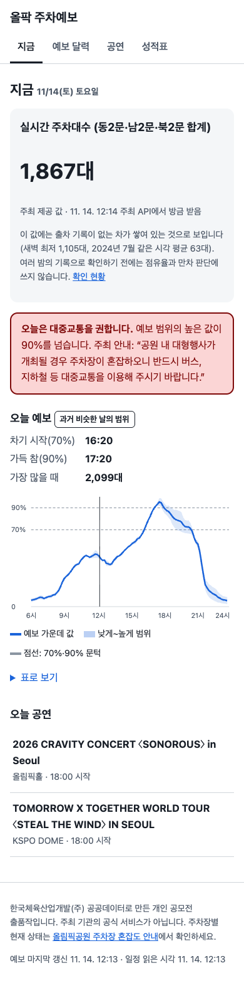
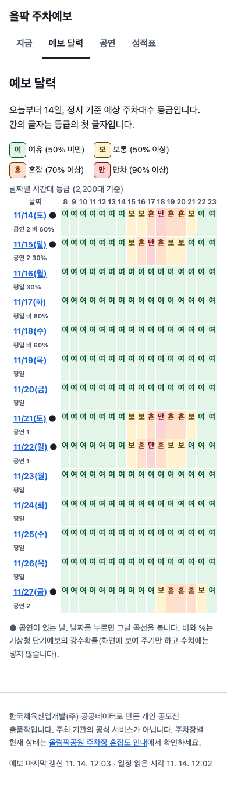
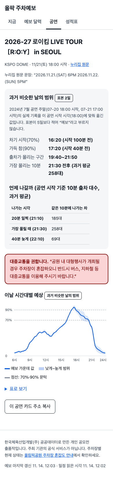

# 올팍 주차예보

올림픽공원 공연일에 주차장이 **몇 시부터 차기 시작해 몇 시에 가득 차는지**, 공연 뒤 **몇 시에 출차가 몰리는지**를 알려 주고, 그 예보가 맞았는지 **성적표**까지 공개하는 웹앱입니다. 한국체육산업개발(주) 2026년도 공공데이터 활용 경진대회 출품작(개인)이며 주최 기관의 공식 서비스가 아닙니다.

- 서비스 주소: https://fiddich-dev.github.io/kspo-parking-forecast/
- 자동 시연: https://fiddich-dev.github.io/kspo-parking-forecast/?demo=1

## 화면

| 지금 | 예보 달력 | 공연 카드 | 성적표 |
|---|---|---|---|
|  |  |  |  |

1. **지금**: 실시간 주차대수(주최 API), 오늘 예보 곡선, 70%·90%에 닿는 시각, 오늘 공연. 높은 범위가 90%를 넘으면 주최의 대중교통 안내 문구를 함께 보입니다.
2. **예보 달력**: 오늘부터 14일 × 08~23시 등급(여유, 보통, 혼잡, 만차). 색과 글자를 함께 씁니다. 기상청 강수확률을 곁들입니다.
3. **공연 카드**: 공연마다 주소가 하나. 과거 공연일 기록을 이 공연 시작 시각에 맞춰 옮긴 차는 시각, 출차가 몰리는 구간, "20분 일찍"과 "40분 늦게" 나갈 때의 10분 출차 대수.
4. **성적표**: 공연 전날 22~24시에 저장한 예보만 실측과 견줍니다. 과거 자료 검증, 계산 방법, 데이터 출처와 마지막 갱신 시각, 외부 호출 기록(키는 가림).

## 쓰는 데이터

| 데이터 | 쓰는 곳 |
|---|---|
| 한국체육산업개발 실시간 주차현황(공공데이터포털 15168686) | 지금 화면, 성적표 실측. 30분마다 기록 |
| 올림픽공원 입출차 정보 2024년 7월(15138735, 215,528건) | 기준 곡선, 공연 가산, 출차 구간, 검증 |
| 주차장 혼잡도 정보(15164156) | 만차 기록과 공연 날짜 대조 |
| 월별주차현황(15131671) | 월별 보정 후보(확인 전이라 아직 적용하지 않음) |
| 영문 공연정보(15149169) | 과거 공연 날짜 |
| 올림픽공원 공연정보(문화공공데이터광장, 3037877) | 공연장별 소요시간 |
| 올림픽공원 일정안내(누리집 공개 화면) | 앞으로의 공연 날짜와 시각(개방 데이터에 없다) |
| 기상청 단기예보(15084084) | 달력의 강수확률(표시만) |

원본 파일은 `data/raw/`에 받은 그대로 둡니다(cp949).

## 계산 방법

- **동시 주차**: 입출차 기록에서 10분마다 "들어와 있고 아직 안 나간 차"를 셉니다. 2024년 7월 자료에서 10분 안에 나간 차가 31.4%라 입차 수를 그대로 쓰지 않습니다.
- **예보** = 요일 유형별(평일, 토요일, 일요일·공휴일) 기준 곡선 + 공연 가산. 가산은 2024-07-20·21 공연일 곡선에서 기준 곡선을 뺀 값을 공연 시작 시각에 맞춰 옮긴 것입니다. KSPO DOME 공연일에만 넣고, 2,200대에서 자릅니다.
- **차기 시작·가득 참**: 예보가 70%와 90%에 닿는 시각. **출차가 몰리는 구간**: 18시 뒤 10분 출차가 그날 저녁 최대의 60% 이상인 구간.
- **이름 규칙**: 하루씩 빼고 맞히는 검증에서 두 기준 예측(요일 유형 평균, 직전 같은 요일)보다 오차가 작을 때만 "예보"라고 씁니다. 공연일은 표본이 2일뿐이라 "과거 비슷한 날의 범위"라고 씁니다. 과거 기록이 없는 공연장은 "자료 부족"입니다.

## 실행

파이썬 3.10 이상, 외부 패키지 없음.

```sh
python3 -m unittest                    # 회귀 시험
python3 pipeline/run.py collect        # 실시간 한 줄 기록 (KSPO_PARKING_API_KEY 필요)
python3 pipeline/run.py build          # site/data/*.json 만들기 (키가 없으면 그 데이터만 빠진다)
python3 pipeline/run.py freeze         # 22~24시에 내일 예보 고정
python3 -m http.server -d site 8000    # 화면 보기
scripts/record_demo.sh                 # 시연 영상(docs/demo/demo.mp4)
scripts/check_no_keys.sh <.env>        # 커밋 전 키 문자열 검사
```

운영(예약 실행, 비용, 키 교체, 장애 대응, 인계)은 [OPERATIONS.md](OPERATIONS.md).

## 확인한 것과 못 한 것

STATUS_PLACEHOLDER
